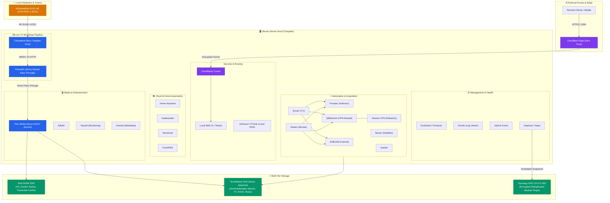
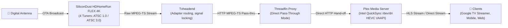

# 🏛️ Rufuslabs

[-0071C5?logo=intel&logoColor=white)](https://www.intel.com/)

A highly automated, containerized home infrastructure environment powering media streaming, live television broadcasting, home automation, automated content acquisition, and private cloud services.

---

## 🏗️ System Architecture

---

## 📺 Live TV & Tuner Signal Pipeline

The Live TV stack bridges over-the-air (OTA) ATSC digital antenna broadcasts into Plex clients with hardware-accelerated transcoding and zero redundant buffer latency:

* **Direct Stream Pass-Through**: Threadfin is configured in direct pass-through mode (`buffer: "-"`). Instead of spawning an intermediate FFmpeg buffering process in RAM, Threadfin immediately hands the raw Tvheadend HTTP socket to Plex, shaving 3–5 seconds off channel change latency and eliminating initial keyframe packet dropouts.
* **Hardware Deinterlacing**: Intel QuickSync (`/dev/dri/renderD128`) decodes 1080i broadcast MPEG-2 and hardware-deinterlaces to progressive 60 fps HEVC on the fly.
* **Cloud EPG Integration**: Plex uses its official cloud-backed Gracenote guide for rich 14-day schedule data, sports matchups, and cover art.

---

## 💻 Hardware & Storage Hierarchy

| Tier | Hardware / Device | Purpose & Configuration |
| :--- | :--- | :--- |
| **Computer** | Ubuntu Server x86_64 | Dedicated host running Docker Compose stacks |
| **GPU / Acceleration** | Intel UHD Graphics (QuickSync) | Hardware encoding/decoding via `/dev/dri` (HEVC/H.264/MPEG-2) |
| **Active Storage** | TerraMaster DAS (Direct Attached) | Primary media repository mounted at `/mnt/media/data` (`tv`, `movies`, `music`, `anime`) |
| **Fast Workspace** | High-Speed NVMe SSD | Host OS, Docker container volumes, database storage, and high-throughput transcode workspace |
| **Backup Target** | Synology NAS (`10.0.0.100`) | Network backup target for encrypted, deduplicated system snapshots via Duplicati / Kopia |
| **Network Tuner** | HDHomeRun FLEX 4K (`10.0.0.29`) | 4-tuner OTA digital broadcast receiver (ATSC 1.0 & NextGen ATSC 3.0) |

---

## 🗂️ Service Stack Directory

All services run as modular Docker Compose stacks located in `/opt/stacks/<stack-name>/`:

| Category | Stacks & Key Services | Description |
| :--- | :--- | :--- |
| **Media & Entertainment** | `plex-stack`, `jellyfin`, `plex-companions` | Media servers, Tautulli statistics, Kometa automated artwork |
| **Live TV & Broadcasting** | `tvheadend`, `threadfin`, `webgrabplus` | Broadcast tuner management, channel proxying, EPG aggregation |
| **Automation & Downloaders** | `media-stack`, `vpn-stack`, `sabnzbd`, `autobrr`, `unpackerr` | Sonarr, Radarr, Prowlarr, Bazarr, Gluetun VPN killswitch, QBittorrent |
| **Audiobooks & Reading** | `audiobookshelf`, `kavita`, `shelfmark`, `metube`, `youtarr` | Audiobooks, comics/ebooks, YouTube/audio archival |
| **Cloud & Security** | `vaultwarden`, `nextcloud`, `freshrss`, `homeassistant`, `cloudflared` | Self-hosted password vault, personal cloud, RSS, smart home, Cloudflare tunnel |
| **System & Observability** | `dockhand`, `dozzle`, `uptime-kuma`, `duplicati`, `backup` | Container orchestration, real-time log tailing, uptime checks, snapshot backups |

---

## 🛡️ Security & Operational Principles

1. **Zero Port Forwarding**: The firewall blocks all incoming WAN ports. External ingress is secured end-to-end through Cloudflare Zero Trust tunnels with identity provider authentication.
2. **Download Isolation (VPN Killswitch)**: BitTorrent traffic is routed exclusively through a Gluetun WireGuard container. If the VPN tunnel drops, traffic instantly halts with no IP leaks.
3. **Dedicated Transcoding Mount**: Plex transcode workspace is isolated on dedicated host SSD storage (`./transcode:/transcode`) with unrestricted throughput, preventing buffer overflows during multi-hour live broadcasts and multi-tuner DVR sessions.
4. **Automated 3-2-1 Backups**: Daily encrypted snapshots of `/opt/stacks` configuration files and container databases are captured and mirrored to the Synology NAS.

---

## 📚 Technical Documentation & Incident Postmortems

Detailed operational runbooks and architectural decision records can be found in [`docs/`](docs/):
* [**Homelab Architecture Diagram**](docs/architecture.md) — Visual overview of network topology and storage mounts.
* [**Live TV Threadfin Buffer Optimization**](docs/live-tv-threadfin-buffer-optimization.md) — Incident postmortem on tuning latency, direct pass-through migration, and Plex program-boundary handling.
* [**Plex Live TV Transcode & Mux Resolution**](docs/live-tv-plex-transcode.md) — Resolution of transcode storage limits and Tvheadend stale mux cleanup.
* [**Backup & Disaster Recovery Strategy**](docs/backups.md) — Backup procedures and restore runbook.

